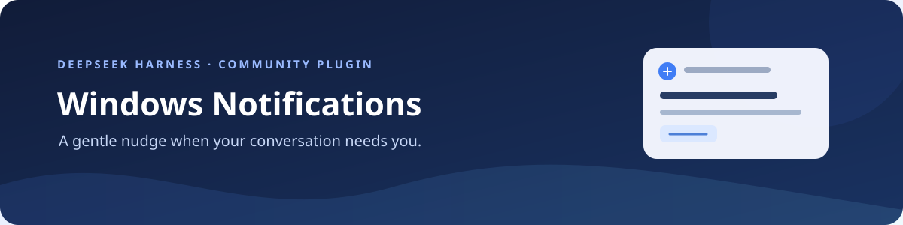
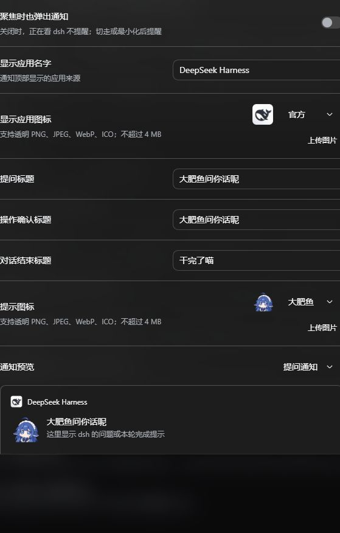

<div align="center">



需要你回答时叫你一声，完成后再提醒你回来。

为 DeepSeek Harness Web 带来可自定义的 Windows 原生通知。

[安装](#安装) · [功能](#功能) · [设置](#设置) · [文件说明](docs/files.md) · [开发与维护](docs/development.md)

完整版：[v0.7.2 下载与更新说明](https://github.com/baigeiy/dsh-windows-notifications/releases/tag/v0.7.2) · 仅需纯文字提醒：[精简版分支](https://github.com/baigeiy/dsh-windows-notifications/tree/lite)

</div>

## 功能

| 场景 | 提示 |
| --- | --- |
| 需要回答或确认操作 | 默认显示「大肥鱼问你话呢」 |
| 本轮对话完成 | 默认显示「干完了喵」 |
| 正在查看 dsh | 默认不弹出通知，可在设置中单独开启 |
| 收到通知 | 「确认收到」收起通知；默认可点击正文或「打开 dsh」切回已有标签页 |

标题、应用来源名称、来源图标和提示图标均可自定义。插件内置「官方」和「大肥鱼」图标，也支持上传图片。

## 安装

适用于 Windows 10/11 x64 上的 dsh Web。发行包已包含所需运行环境和原生程序，无需另外安装 Python、uv、Git 或编译器。首次使用需要以管理员身份运行一次初始化脚本。

1. 从 [GitHub Releases](https://github.com/baigeiy/dsh-windows-notifications/releases) 下载发行 ZIP，解压到长期保留的目录，例如 `E:\dsh-plugins\windows-notifications`。

2. 在管理员 PowerShell 中进入解压目录，运行一次初始化：

   ```powershell
   cd E:\dsh-plugins\windows-notifications
   powershell -ExecutionPolicy Bypass -File .\setup.ps1
   ```

3. 在平时使用 dsh 的终端安装，然后重启 dsh Web 并刷新页面。如果解压到了其他目录，请将命令中的路径替换为实际目录：

   ```powershell
   dsh plugin --profile web add "link:E:/dsh-plugins/windows-notifications"
   ```

打开 **设置 → Windows 通知**，点击「保存并发送测试」。在 **插件市场 → 已安装** 可以启用或停用插件。

更新或移动插件目录后，请在新目录重新运行初始化。发行页也提供 `.tgz` 包，供 dsh 原生安装命令使用；通过插件市场或 GitHub 安装后，也需在安装目录运行一次 `setup.ps1`。

<details>
<summary>通过插件市场或 GitHub 安装后初始化</summary>

插件安装后尚未初始化时会报错。先在普通终端查找 web profile 中实际安装的插件目录：

```powershell
dsh plugin --profile web exec node -p "require('node:path').dirname(require.resolve('dsh-windows-notifications/package.json'))"
```

在管理员 PowerShell 中进入输出的目录，运行 `powershell -ExecutionPolicy Bypass -File .\setup.ps1`，然后重新启用插件或重启 dsh Web。此步骤需要在每次安装位置改变后重新执行。

包管理器更新可能更换目录，目录里的设置也可能无法保留。更新前备份 `settings.json` 和自定义图片 `custom-*.png`，更新后将需要保留的文件恢复到新目录。推荐使用上面的 ZIP 与稳定的本地链接目录。

有关 Git 源码和预构建 tarball 的安装方式，参见 [DSH 官方插件发布教程](https://github.com/deepseek-ai/deepseek-harness/blob/master/docs/user/develop/basic/publish.zh.md)。

</details>

## 设置



| 选项 | 默认值 |
| --- | --- |
| 聚焦时也弹出通知 | 关闭 |
| 点击通知打开 DSH | 开启 |
| 显示应用名字 | DeepSeek Harness |
| 显示应用图标 | 官方 |
| 提示图标 | 大肥鱼 |
| 提问 / 操作确认标题 | 大肥鱼问你话呢 |
| 对话结束标题 | 干完了喵 |

图片支持 PNG、JPEG、WebP、ICO，最大 4 MiB、最长边 4096 像素。保存立即生效；测试通知临时忽略聚焦状态。系统声音、权限和勿扰设置仍适用。

<details>
<summary>使用其他 dsh Web 端口</summary>

默认服务地址为 `http://127.0.0.1:3080/`。使用其他端口时，在 web profile 的 `cordis.patch.yml` 中覆盖完整配置：

```yaml
- id: local-windows-notifications
  config:
    baseUrl: http://127.0.0.1:3081/
    timeoutMs: 15000
```

</details>

## 使用说明

「点击通知打开 DSH」开启时，点击通知正文或「打开 dsh」会选择已有的 dsh 标签页；没有打开时才新开页面。关闭并保存后，新通知隐藏「打开 dsh」按钮，点击正文只收起通知；旧通知中已有的「打开 dsh」按钮也只收起通知，不打开或切换浏览器。此开关与「聚焦时也弹出通知」相互独立。

「确认收到」只收起通知，不会代替回答或批准操作。多个 dsh 标签页同时打开时优先已有窗口当前显示的 DSH 页面，否则选择首个匹配标签，暂不定位具体会话。

点击激活已在 Edge 实测，其他浏览器的识别范围和限制见[开发与维护](docs/development.md#运行方式)。

<details>
<summary>开发与维护</summary>

查看[文件说明](docs/files.md)，了解项目中各文件的用途；查看[开发与维护](docs/development.md)，了解运行方式、本机数据、卸载与验证方法。

</details>

这是社区插件，非官方出品。代码采用 [MIT](LICENSE) 许可证，图片和商标说明见 [NOTICE.md](NOTICE.md)。
